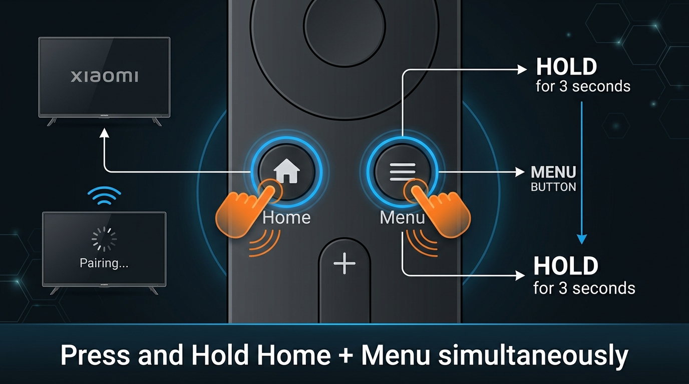
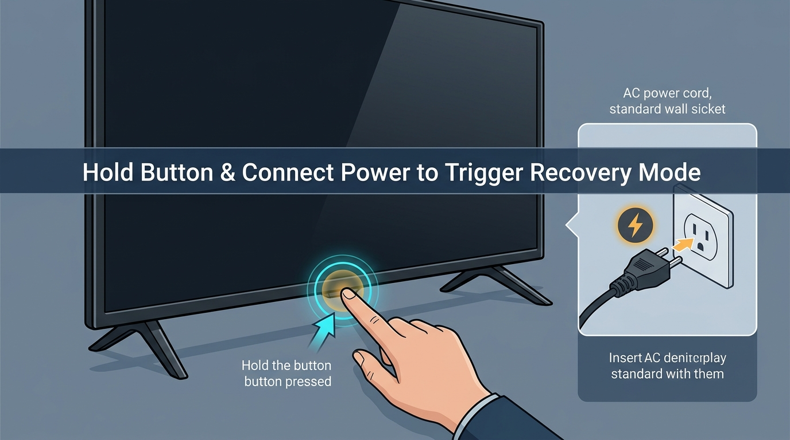

# Xiaomi Mi TV 4A (Magnolia): PatchWall to Official Android TV 9 Upgrade Guide

[](https://github.com/akshit14243/mi-tv-patchwall-to-android)
[](LICENSE)
[-blue?style=for-the-badge)](docs/FIRMWARE_INFO.md)
[-green?style=for-the-badge)](docs/FIRMWARE_INFO.md)

> **Authored & Reverse-Engineered by [Akshit Saini (@akshit14243)](https://github.com/akshit14243)**  
> Complete guide, reverse-engineered recovery automation scripts (`xiaomi_update-magnolia`), and step-by-step instructions to upgrade legacy Xiaomi Mi TVs running PatchWall (Android 6) to official **Android TV 9.0 (Pie)** with Google Play Store, Chromecast, and Google Assistant.

---

## 📺 Supported Devices

This update specifically targets the Xiaomi hardware board codename **`magnolia`**:
* **Xiaomi Mi TV 4A 32-inch** (`L32M5-AL` / `L32M5-AI`)
* **Xiaomi Mi TV 4A 43-inch** (`L43M5-AL` / `L43M5-AI`)
* Select regional Mi TV models running base firmware build versions: `16938`, `19764`, `16940`, `19766`.

> [!NOTE]
> Check your TV under **Settings > About TV > Model**. Confirm your device is a Mi TV 4A (32" or 43").

---

## 🔍 The Missing File: Reverse Engineering `xiaomi_update-magnolia`

Many users find YouTube tutorials or technician spreadsheets promising the PatchWall-to-Android-9 update, but the required companion file **`xiaomi_update-magnolia`** is often missing or hosted on expired Google Drive links.

### What is this file?
Stock Xiaomi TV recovery does not offer an interactive user file explorer. When you boot the TV into recovery mode via remote keys, the recovery daemon scans the root directory of your USB drive (`/udisk`) for an automated batch instruction file:
* **File Name:** `xiaomi_update-magnolia` (or generic fallback `xiaomi_update`)
* **File Type:** Plain text with **NO file extension** (not `.txt`, not `.bin`)
* **Payload:** Instructs the recovery kernel to locate and flash the firmware archive:
  ```text
  --update_package=/udisk/update-magnolia_p_rel_190830r2854-3698-user.zip
  ```

This repository includes pre-built template files as well as automated PowerShell/Bash scripts to generate them in seconds.

---

## 🛠️ Requirements

1. **USB Flash Drive:**
   * Capacity: 8 GB or 16 GB recommended (must be FAT32 formatted, MBR partition).
2. **Firmware Package:**
   * File: `update-magnolia_p_rel_190830r2854-3698-user.zip` (Size: ~758 MB / build `3698`).
3. **Recovery Trigger Files (Included in this repo):**
   * `xiaomi_update-magnolia`
   * `xiaomi_update` (fallback)
4. **Mi TV Remote** (with working batteries).

---

## 🚀 Step-by-Step Installation Guide

### Step 1: Format the USB Drive
1. Insert your USB flash drive into your computer.
2. Format the drive as **FAT32** (Allocation unit size: Default).
   * *Note: Recovery cannot read NTFS or exFAT formatted drives.*

---

### Step 2: Copy Files to USB Root
Place the following files directly in the **root (main directory)** of your USB drive:

```text
[USB Drive E:\]
  ├── update-magnolia_p_rel_190830r2854-3698-user.zip
  ├── xiaomi_update-magnolia
  └── xiaomi_update
```

*(You can copy `xiaomi_update-magnolia` and `xiaomi_update` directly from the `templates/` folder in this repo).*

#### Or Generate Automatically:
If your firmware `.zip` has a different name, use the included helper script:

* **On Windows (PowerShell):**
  ```powershell
  .\scripts\generate_update_command.ps1 -UsbDrive "E:\" -ZipFileName "YOUR_FIRMWARE_NAME.zip"
  ```
* **On Linux / macOS:**
  ```bash
  chmod +x ./scripts/generate_update_command.sh
  ./scripts/generate_update_command.sh "/Volumes/MY_USB" "YOUR_FIRMWARE_NAME.zip"
  ```

---

### Step 3: Trigger Recovery on the TV

Follow these exact hardware steps:

#### 1. Press and Hold Remote Buttons
Unplug the TV power cable from the wall. Point your remote directly at the Mi logo at the bottom center of the TV. Press and hold both the **`Home`** and **`Menu`** buttons at the same time:

<p align="center">
  
</p>

#### 2. Reconnect Power & Boot
While keeping both buttons firmly pressed, plug the power cable back into the wall outlet (or press the physical button underneath the center chin of the TV):

<p align="center">
  
</p>

#### 3. Automatic Flashing
* Keep holding the buttons until the **Mi Logo** appears on the screen.
* The recovery daemon will automatically detect `/udisk/xiaomi_update-magnolia`.
* The screen will transition to the Android system update installation progress bar.
* **Do NOT power off or remove the USB drive** during the installation (takes approx. 5–8 minutes).

---

## 🌟 What Changes After the Update?

| Feature | Old Firmware (PatchWall) | Upgraded Android TV 9 |
|---|---|---|
| **Android Version** | Android 6.0.1 (Marshmallow) | **Android 9.0 (Pie)** |
| **Google Play Store** | ❌ No official Play Store | ✅ Full Android TV Google Play Store |
| **Chromecast** | ❌ Third-party casting apps | ✅ Built-in Google Cast support |
| **Voice Search** | ❌ Limited PatchWall search | ✅ Google Assistant Voice Control |
| **Streaming Apps** | ❌ Deprecated / outdated APKs | ✅ Modern Netflix, Prime, YouTube, Hotstar |
| **Dual Interface** | PatchWall Only | Toggle between **Android TV Home** & **PatchWall** |

---

## 📂 Repository Structure

```text
├── assets/
│   ├── remote_recovery_combo.jpg    # Visual guide for remote button combo
│   └── tv_power_recovery.jpg        # Visual guide for power trigger
├── docs/
│   ├── FIRMWARE_INFO.md             # Technical metadata, build keys, device tree
│   └── TROUBLESHOOTING.md           # Fixes for bootloop, signature check, USB errors
├── scripts/
│   ├── generate_update_command.ps1  # Automated PowerShell recovery file generator
│   └── generate_update_command.sh   # Automated Bash recovery file generator
├── templates/
│   ├── xiaomi_update-magnolia       # Pre-configured trigger file for magnolia 3698
│   └── xiaomi_update                # Universal fallback trigger file
├── .gitignore
├── LICENSE
└── README.md
```

---

## ⚠️ Disclaimer & Safety

* Updating TV firmware carries inherent risks. Ensure your power supply is stable and that you do not interrupt the update process.
* This repository provides documentation, automation scripts, and recovery trigger manifests for educational and repair purposes.
* All trademarks, product names, and brand names are property of their respective owners (Xiaomi Inc. / Google LLC).

---

## 🤝 Contributing & Support

Found an issue or have a tip for another TV model? Pull requests and issue submissions are welcome!

Created with ❤️ by **[Akshit Saini](https://github.com/akshit14243)**. If this guide helped unbrick or upgrade your TV, please consider giving this repository a ⭐!
